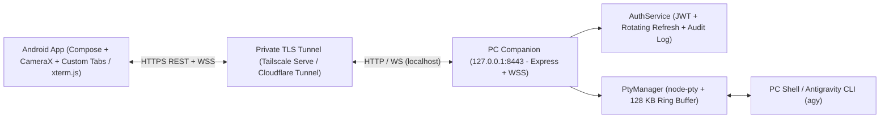

<div align="center">

# 🚀 Antigravity Remote

**Control Google Antigravity (`agy`) and persistent PC terminal sessions from your Android phone over an encrypted TLS tunnel — with zero port forwarding.**

[](https://developer.android.com/)
[](https://kotlinlang.org/)
[](https://nodejs.org/)
[](https://www.typescriptlang.org/)
[](https://opensource.org/licenses/MIT)

<br />


<br /><br />

[📖 Architecture](#-tech-stack--architecture) &nbsp;|&nbsp; [⚡ Quick Start](#-frictionless-quick-start) &nbsp;|&nbsp; [🐛 Report Bug](https://github.com/goateddhleminh/android-antigravity-remote/issues)

</div>

---

## ✨ Core Features

* **🔗 Zero-Server Remote Control & Companion Modes**: Connect directly to `https://antigravity.google.com` via QR scan or link paste (Chrome Custom Tabs / In-App WebView), or pair with the local Node.js PC Companion for full PTY terminal streaming.
* **⚡ Lossless Scrollback Delta Replay**: Persistent `node-pty` sessions maintain a 128 KB ring buffer with monotonic sequence tracking (`sinceSeq`), replaying only missed terminal output on reconnect.
* **🔐 Hardware-Backed Security**: Credentials and tokens are encrypted with Android Keystore (`AES256-GCM` / `EncryptedSharedPreferences`), gated behind `BiometricPrompt`, and paired via single-use 5-minute QR tokens + rotating refresh tokens.
* **⌨️ Mobile-First Terminal Controls**: Built-in offline `xterm.js` 5.5 renderer with quick-command chips (`agy`, `agy --mode=plan`, `/goal`, `git status`), sticky `CTRL`/`ALT` modifiers, `S-TAB`, arrow keys, and clipboard copy/paste.
* **🛡️ Private Tunnel Ready**: Companion binds strictly to `127.0.0.1:8443` and pairs seamlessly with Tailscale Serve (`tailscale serve`) or Cloudflare Tunnel (`cloudflared`) for end-to-end TLS without router port forwarding.

---

## 🏗️ Tech Stack & Architecture

| Layer | Technologies |
| :--- | :--- |
| **Android App** | Kotlin, Jetpack Compose (Material 3), CameraX, ML Kit Barcode Scanning, OkHttp, Kotlinx Serialization, `androidx.webkit`, `androidx.browser` (Custom Tabs) |
| **Terminal UI** | Bundled offline `xterm.js` 5.5 + `FitAddon` (zero external CDN requests) |
| **PC Companion** | Node.js 20+, TypeScript 5.8, Express 5, `ws` 8, `node-pty`, `bcryptjs`, `jsonwebtoken`, `express-rate-limit` |
| **Security & Auth** | Android Keystore (`EncryptedSharedPreferences`), `BiometricPrompt`, 15m JWTs, rotating 30d refresh tokens, JSON-lines audit log |
| **Transport / Tunnel** | Tailscale Serve (WireGuard + automatic HTTPS) or Cloudflare Tunnel (`cloudflared`) |



---

## ⚡ Frictionless Quick Start

### Prerequisites
* **PC**: Node.js `>= 20.x`, Antigravity CLI (`agy`) on `PATH`, and (on Windows if `node-pty` compiles locally) Visual Studio Build Tools (*Desktop development with C++*).
* **Android**: Android 8.0+ (`minSdk 26`), JDK 17 (to build from source).
* **Tunnel**: [Tailscale](https://tailscale.com/) (recommended) or `cloudflared`.

### 1. Clone & Start the PC Companion

```bash
git clone https://github.com/goateddhleminh/android-antigravity-remote.git
cd android-antigravity-remote/agy-remote/companion

npm install
npm run build
```

Expose port `8443` privately with Tailscale HTTPS, then start the companion:

```powershell
# Expose local companion over Tailscale HTTPS
tailscale serve --bg https / http://127.0.0.1:8443

# Start companion with your Tailscale HTTPS URL
$env:AGY_PUBLIC_URL = "https://<your-pc>.<your-tailnet>.ts.net"
$env:AGY_DEFAULT_CWD = "C:\Projects"
npm start
```

### 2. Build & Install the Android App

```bash
cd ../android
./gradlew testDebugUnitTest assembleDebug

# Install via ADB
adb install -r app/build/outputs/apk/debug/app-debug.apk
```

### Environment Variables (`companion/`)

| Variable | Type | Description | Default / Example |
| :--- | :--- | :--- | :--- |
| `AGY_HOST` | `string` | Local bind address for the companion server | `127.0.0.1` |
| `AGY_PORT` | `number` | Local port for HTTP & WebSocket server | `8443` |
| `AGY_PUBLIC_URL` | `string` | Public HTTPS tunnel URL embedded in startup QR code | `https://my-pc.tailnet.ts.net` |
| `AGY_DEFAULT_CWD` | `string` | Default working directory for new PTY sessions | `process.cwd()` |
| `AGY_SHELL` | `string` | Override auto-detected shell binary | `pwsh.exe` / `/bin/bash` |
| `AGY_DEVICE_NAME` | `string` | Friendly host name shown in the Android app | `os.hostname()` |
| `AGY_ADMIN_EMAIL` | `string` | Admin email for password login fallback | `admin@local` |
| `AGY_ADMIN_PASSWORD` | `string` | Admin password (auto-generated once if omitted) | *(random 12-byte base64url)* |
| `AGY_DATA_DIR` | `string` | Directory for `state.json` and `audit.log` | `~/.agy-remote` |
| `AGY_MAX_SESSIONS` | `number` | Maximum concurrent active PTY sessions | `16` |
| `AGY_SCROLLBACK_BYTES` | `number` | Per-session scrollback ring buffer size | `131072` (128 KB) |

---

## 📁 Project Directory Tree

```text
agy-remote/
├── companion/                         # Node.js + TypeScript PC Companion
│   ├── src/
│   │   ├── index.ts                   # Entry point + startup QR pairing code
│   │   ├── config.ts                  # Cross-platform shell detection & env config
│   │   ├── protocol.ts                # Typed JSON WebSocket message schema
│   │   ├── ptyManager.ts              # Persistent node-pty sessions + 128 KB ring buffer
│   │   ├── auth.ts                    # Bcrypt login, QR pairing, JWT & refresh rotation
│   │   ├── audit.ts                   # JSON-lines auth & session audit logger
│   │   └── server.ts                  # Express + ws server (127.0.0.1, rate-limited)
│   └── test/                          # Vitest auth & PTY persistence tests
└── android/                           # Kotlin + Jetpack Compose Android App
    └── app/src/
        ├── main/
        │   ├── assets/terminal/       # Offline xterm.js 5.5 + FitAddon
        │   └── kotlin/com/agyremote/app/
        │       ├── MainActivity.kt                  # Entry point + Biometric lock gate
        │       ├── model/                           # PairedHost, RemoteDevice, QuickCommands
        │       ├── security/                        # EncryptedSharedPreferences + BiometricHelper
        │       ├── network/                         # CompanionApiClient, WSS client, ReconnectPolicy
        │       ├── service/                         # Foreground Service notification
        │       └── ui/screens/                      # RemoteControlHome, WebView, QR, Terminal
        └── test/kotlin/com/agyremote/app/           # JUnit unit tests
```

---

## 🗺️ Roadmap & Contributing

- [x] Direct Antigravity Remote Control QR / link launcher with Chrome Custom Tabs & WebView fallback
- [x] Biometric App Lock & Android Keystore encrypted storage
- [x] PC Companion PTY server with JWT auth, refresh rotation, and `sinceSeq` delta replay
- [x] Wire PC Companion terminal mode toggle directly into `MainActivity` navigation
- [x] Fix OAuth handoff URL, CameraX lifecycle disposal, and concurrent JWT refresh `Mutex`
- [ ] Add GitHub Actions CI workflow for Gradle & Vitest

Contributions are welcome! Feel free to open an [issue](https://github.com/goateddhleminh/android-antigravity-remote/issues) or submit a pull request.

### License

Distributed under the **MIT License**. See `LICENSE` for details.
